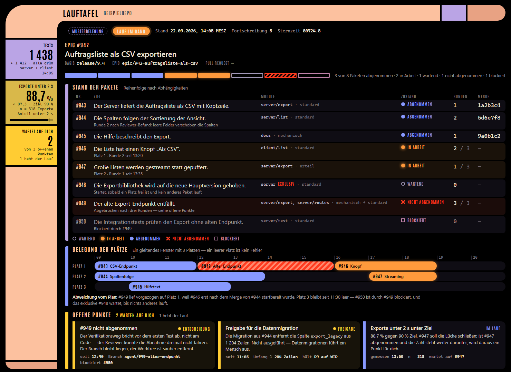

# agent-skills

Die versionierte Quelle unserer Claude-Code-Skills: Agenten setzen damit freigegebene Epics aus
Gitea um, von der Freigabe bis zum Pull Request. Dieses README sagt, was du als Nutzer wissen
musst: wie ein Lauf arbeitet, welche Regeln greifen, wo du entscheidest und was danach aufgeräumt
ist. Einrichten: [`INSTALL.md`](INSTALL.md). Begriffe: [`CONTEXT.md`](CONTEXT.md).

## Der Ablauf


Die orangen Halte sind die Stellen, an denen du entscheidest. Dazwischen läuft alles ohne
Rückfrage; den Stand zeigen Gitea und KIBO.

1. **Plan klären und Epic schneiden** mit den vorgelagerten Skills (`grill-with-docs`, `to-spec`,
   `to-tickets`).
2. **Freigeben:** Label `ready-for-agent` an der Spec oder an den Kind-Tickets.
3. **`/epic #<nr>` starten** und am Vorab-Tor einmal alle Fragen beantworten.
4. **Pull Request prüfen und mergen.** Das tut kein Agent.
5. **`/epic-nacharbeit`** für die offenen Punkte, nach dem Merge **`/epic-aufraeumen`**.

## Die Skills

| Skill | Wofür |
|---|---|
| `epic` | Ein Epic (Kind-Tickets oder Spec) auf einem Epic-Branch umsetzen, endet mit offenem PR |
| `epic-nacharbeit` | Die offenen Punkte eines abgeschlossenen Laufs in Fragerunden klären und erledigen |
| `epic-aufraeumen` | Nach dem Merge Worktrees und Branches abräumen, nur was nachweislich gemergt ist |
| `epic-flotte` | Optional: mehrere Epics gleichzeitig, geführt von einem Admiral |
| `epic-lagebesprechung` | Optional: im laufenden Chat alles abholen, was bei dir liegt |
| `mail-antwort` | Eine Anwender-Mail recherchieren, bei Bedarf umsetzen, Antwort entwerfen |
| `persona-review` | Eine Funktion von Persona-Agenten lokal durchspielen lassen, Befunde nachprüfen, Runden vergleichen |
| `leitstand` | Optional, nur mit zweitem Konto: aus der Hauptsitzung dessen Sitzungen starten, überwachen, ihre PRs mergen. Eingerichtet mit `arbeitspferd/einrichten.ps1` |

Vorgelagert sind die Skills aus dem Plugin `mattpocock-skills` (`grill-with-docs`, `grilling`,
`to-spec`, `to-tickets` …). Sie werden nicht hierher kopiert; [`mattpocock-skills/`](mattpocock-skills/README.md)
legt fest, wie sie für Gitea eingerichtet werden.

## Was ein Projekt braucht

Alle Epic-Skills lesen im Zielprojekt die Adapterdatei **`.claude/epic.md`**
([Vertrag mit allen Schlüsseln](epic/references/adapter.md)). Die maschinenlesbaren Werte stehen
im **Frontmatter**; ohne Frontmatter laufen die Skripte nicht, und der Lauf fragt am Vorab-Tor
nach. Bis Oktober 2026 hießen die Skills `prd…`; alte Adapter werden weiter gelesen. Die Schlüssel,
die am meisten ausmachen:

| Schlüssel | Was er bewirkt |
|---|---|
| `test_commands`, `lint_commands` | womit jedes Paket geprüft wird. Eine Worker-Grenze steht als feste Zahl, nicht als Anteil der Kerne: Mehrere Testläufe laufen gleichzeitig |
| `test_isolation_env` oder `isolation: none-needed` | erst damit laufen bis zu drei Pakete gleichzeitig; sonst ist `window` 1 |
| `link_dirs`, `env_files` | Abhängigkeitsordner werden in jeden Worktree verlinkt statt installiert, Env-Dateien kopiert |
| `shared_services`, `worktree_may_start` | welche Dienste geteilt laufen und was ein Paket selbst starten darf |
| `acceptance_commands` | Prüfungen mit vollem Stack, einmal vor dem Pull Request |
| `gate_approvals`, `no_access` | was immer am Vorab-Tor vorgelegt wird |

Ein Kind-Ticket braucht eine Abnahmeliste und einen Verifikationsweg, sonst überspringt der Lauf
es mit Kommentar. Eine Spec hat sieben feste Abschnitte; ihre User Stories sind die Abnahmeliste.

## `/epic` — ein Lauf


Deine Sitzung ist der **Orchestrator**: Er schneidet, prüft nach und mergt in den Epic-Branch, die
Pakete setzen Subagenten um.

1. **Rüsten:** Reste toter Sitzungen abräumen, Epic-Worktree anlegen, den Ausgangsstand von Tests
   und Lint messen.
2. **Lesen und schneiden:** das Issue ganz lesen, Pakete bilden, jedem eine **Paketklasse** geben
   (mechanisch, Standard, Urteil), Abhängigkeiten und Kollisionen als Graph.
3. **Vorab-Tor:** alles Fragwürdige in einer Runde, mit Antwortmöglichkeiten und Empfehlung.
4. **Je Paket**, bis zu `window` gleichzeitig: eigener Branch und Worktree → Implementer →
   Reviewer → der Orchestrator fährt die Verifikation selbst → Commit → Sofortmerge in den
   Epic-Branch. Ein frei werdender Platz wird sofort neu belegt.
5. **Abschluss:** Gesamtlauf aller Tests, Abnahmestufe, Push, Pull Request, Abschlusskommentar.

Den Stand zeigt die **Lauftafel** im Browser — hier mit den Musterdaten der Vorlage:



**Womit du rechnen kannst** (7 Läufe, 61 Pakete, 26.10.–11.11.2026): Ein Implementer braucht im
Median 12 Minuten (Urteil 22, Standard 7, mechanisch 1), ein Reviewer 5. Worktree anlegen und
abräumen dauern Sekunden. Die Zeit geht zu gut der Hälfte in die Arbeit der Modelle und zu einem
guten Viertel in Testläufe.

## Die Regeln, die greifen

**Was ein Lauf nie tut**

- Er mergt und pusht nie in den Hauptzweig oder die Basis; er endet mit einem offenen Pull
  Request. Gepusht wird nur auf das Remote aus dem Adapter. Das Hauptverzeichnis wird nie auf einen
  anderen Branch umgeschaltet. Diese drei sperrt ein Hook (`guard.ps1`).
- Er führt keine Datenmigration aus, löscht oder überspringt keine Tests und baut nichts über die
  Abnahmeliste hinaus. Reviewer legen keine Issues an.

**Wann er fragt**

- Einmal, am Vorab-Tor. Danach hält er nicht mehr an: Was schiefgeht, lässt ein Paket zurück
  (Branch bleibt, Ticket bekommt `status/haengt`), seine Nachfolger werden blockiert, alle anderen
  laufen weiter.
- Die Ausnahme ist die **RAM-Bremse**: Ab 85 % belegtem Speicher startet kein neues Paket, bis
  wieder Platz ist oder du freigibst. Ein voller Stack läuft im Projekt immer nur einmal.

**Wie ein Paket geprüft wird**

- **Implementer** bauen die kleinste vollständige Änderung: erst vorhandenen Code, dann
  Standardbibliothek und installierte Abhängigkeiten, sonst das Minimum. Sie testen gezielt und
  fahren am Ende einen Volllauf. Ihr Bericht endet mit dem, was sie ausgelassen oder nicht geprüft
  haben.
- **Reviewer** prüfen Spec und Standards getrennt und melden Befunde als Muss, Sollte, Kann, jeden
  mit Fundstelle und konkretem Fall. Nur ein Muss-Befund löst eine neue Runde aus; eine
  strukturelle Abweichung wiederholt die Runde eine Paketklasse höher (Eskalation). Nach drei
  Runden bleibt das Paket zurück.
- **Der Orchestrator** glaubt keinem Bericht: Er fährt den Verifikationsweg selbst und vergleicht
  Test- und Lint-Zahlen mit dem Ausgangsstand. Eine gesunkene Testzahl ist ein Befund, auch wenn
  alles grün ist.
- **Kein Zug endet wartend.** Ein Subagent, der ohne Bericht zurückkommt, wird einmal fortgesetzt
  und dann ersetzt.

**Was in Gitea steht**

- Jedes berührte Issue bekommt einen Kommentar: je Abnahmepunkt die Fundstelle, die gefahrene
  Verifikation, die offenen Punkte. Nichts existiert nur im Chat.
- Drei Statuslabels zeigen den Zustand (`status/in-arbeit`, `status/blockiert`, `status/haengt`);
  sie steuern nichts.
- Der Pull Request trägt `WIP:`, solange etwas bei dir liegt, und schließt abgenommene Kinder über
  `Closes`.

## Modelle und Denkstufen

Die Paketklasse wählt Modell und Denkstufe; das teuerste Modell sitzt nur dort, wo entschieden
wird. Die Agent-Typen liegen unter `agents/`.

| Rolle | Agent-Typ | Modell, Denkstufe |
|---|---|---|
| Orchestrator eines Laufs | — | das Modell deiner Sitzung; unter der Flotte Opus, mittel |
| Admiral der Flotte | — | Fable 5.2, hoch |
| Kundschafter (liest nur) | `epic-kundschafter` | Haiku, niedrig |
| Implementer *mechanisch* | `epic-implementer-mechanisch` | Sonnet, niedrig |
| Implementer *Standard* | `epic-implementer-standard` | Sonnet, mittel |
| Implementer *Urteil*, erste Eskalation von Standard | `epic-implementer-urteil` | Opus, mittel |
| Implementer nach einer Eskalation aus Urteil | `epic-implementer-urteil-hoch` | Opus, hoch |
| Reviewer *mechanisch* und *Standard* | `epic-reviewer-standard` | Sonnet, hoch |
| Reviewer *Urteil* | `epic-reviewer-urteil` | Opus, mittel |
| Lauf als Subagent unter der Flotte (Rückfall) | `epic-lauf` | Opus, mittel |

Der Reviewer ist nie schwächer als der Implementer. Der Admiral hat wenige, folgenreiche Züge,
während die Implementer die Masse der Tokens verbrauchen; deshalb läuft nur er auf Fable.

## `/epic-flotte` — mehrere Epics gleichzeitig


- **Starten:** die Sitzung auf Fable stellen (`/model fable`, `/effort high`), dann
  `/epic-flotte #15 #21 #32` oder ohne Argument für alle freigegebenen Epics.
- **Jedes Epic läuft als eigene Sitzung,** die du in der Seitenleiste öffnen kannst; im Terminal
  ohne Sitzungswerkzeuge als Subagent. Wie viele gleichzeitig laufen, bestimmt die Kollisionsstufe
  je Paar, nie mehr als vier. Der Träger Sitzung ist an einem echten Einsatz noch nicht erprobt
  (Stand 12.11.2026).
- **Entscheidungsrecht:** Der Admiral entscheidet die Fragen der Läufe endgültig; du bestätigst
  nichts vorab, sondern liest nach und widerrufst, was dir nicht passt. Die Grenze: Was sich nach
  dem Fakt nicht widerrufen lässt, bleibt bei dir, und der Lauf wartet.

  | Der Admiral entscheidet | Immer du |
  |---|---|
  | jede Frage eines Laufs, die bis zum Merge umkehrbar ist, auch gegen die Empfehlung des Laufs und mit eigener Antwort; Belegung und Reihenfolge; Handgriffe der Nacharbeit | Produktiv- und Stammdaten, Zugriffe, Freigaben aus `gate_approvals`, das Lockern einer Regel, eine Freigabe trotz RAM-Bremse, Mergen, Remote-Branch löschen, alles nach dem Merge |

- **Nachlesen:** Jede Entscheidung steht als Kommentar am betroffenen Issue und im Pull Request
  des Epics. Die einflussreichen — Abweichung von der Empfehlung des Laufs, eigenes Urteil,
  geänderter Umfang, etwas bleibt ungeprüft — stehen zusätzlich im **Entscheidungsprotokoll**, den
  Kommentaren am Issue `Flottenlogbuch`: Frage, Lage, Optionen, Entscheidung, Warum.
- **Widerrufen:** im Chat, in der Lagebesprechung oder als Kommentar. Der Admiral gibt den
  Widerruf an den Lauf und schlägt die Regel vor, die ihn künftig erspart: für das Projekt im
  Abschnitt „Entscheidungsregeln" des Adapters, oder für alle Projekte als Änderung dieses Skills.
- **Bremsen:** Die Verbrauchsbremse liest 5-Stunden- und Wochenlimit (bei Gelb nichts Neues, bei
  Rot Pause bis zum Reset), die RAM-Bremse den Speicher. Den Stand schreibt der Admiral ins Issue
  `Flottenlogbuch`, das KIBO anzeigt.

Die **Flottentafel** zeigt dir im Browser, wo jeder Lauf steht und was bei dir liegt — hier mit
den Musterdaten der Vorlage:


## Nach dem Lauf

- **`/epic-nacharbeit`** arbeitet ab, was der Lauf offen gelassen hat. Jeder Punkt wird einzeln in
  einer Fragerunde entschieden, bevor er angefasst wird: passt er in die Sitzung oder braucht er
  ein Ticket. Issues legt der Skill nur nach deiner ausdrücklichen Entscheidung an. Sind alle
  Kinder zu, schließt er das Epic.
- **`/epic-aufraeumen`** läuft nach dem Merge. Es löscht nur, was nachweislich im Basiszweig liegt,
  nie mit `-D` oder `--force`, und einen Remote-Branch nur nach deiner Zustimmung.

## Aufräumen und Speicher

| Was | Wer räumt | Wann |
|---|---|---|
| Worktree, Prozesse und Compose-Projekt eines Pakets, samt der Images, die es gebaut hat | `worktree.ps1 -Action Down` | nach jedem Paket |
| Worktrees und Prozesse toter Sitzungen | `CleanupStale` | zu Beginn von `/epic` und `/epic-aufraeumen`, je Repository |
| dasselbe über alle Repositorys, dazu alte Temp-Ordner der Läufe, verwaiste WSL-Swap-Dateien, verwaiste Docker-Images, Build-Cache älter als sieben Tage | `sweep.ps1` | am Ende von `/epic-aufraeumen`, oder von Hand |

Von Hand, erst als Probelauf:

```powershell
powershell -NoProfile -ExecutionPolicy Bypass -File "$HOME\.claude\skills\epic\scripts\sweep.ps1" -Root "$HOME\git" -DryRun
```

**Was stehen bleibt und bei dir liegt:** schmutzige Worktrees (sie werden gemeldet, dort kann
Arbeit liegen), Worktrees ohne Lock, die nicht von `Up` stammen, Branches nicht abgenommener
Pakete, Docker-Volumes und markierte Images, Repositorys ohne Adapter-Frontmatter. Die Datei der
WSL-Platte schrumpft nie von selbst, auch wenn innen Platz frei wird.

**Speicher:** Den Arbeitsspeicher treiben die Testläufe, nicht die Worktrees — je Lauf mehrere
Worker, und bis zu drei Pakete plus Orchestrator laufen gleichzeitig. Dagegen stehen die feste
Worker-Zahl im Adapter und die RAM-Bremse.

## `/epic-lagebesprechung` — wenn du Zeit hast


Ein Einschub, kein eigener Lauf: Aufgerufen im Chat des Admirals oder Orchestrators, ändert sie
deren Ablauf nicht.

## `mail-antwort` — Anwender-Mail beantworten


## `persona-review` — Bedienung über Runden messen

4–7 Persona-Agenten in festen Rollen (Neuling, Spezialist, Leitung, „nur Maus“, „liest wörtlich“ …)
spielen synthetische Fälle auf einer **lokalen** Instanz mit Datenbankkopie durch. Sie sehen
Screenshots wie ein Mensch, zählen jeden Klick, getrennt nach reiner Sucherei, und schreiben Berichte
in fester Form. Der Host prüft jeden Fehlerbefund im Code nach, bevor er als Fehler gilt, legt dir
die offenen Entscheidungen vor und macht daraus Tickets für `/epic`. Nach den Fixes läuft eine neue
Runde mit denselben Fällen auf neuen Datensätzen; erst der Vergleich zeigt, ob die Bedienung
leichter wurde. Eine Abnahme-Probe mit Gegenprobe schließt ab.

- **Starten:** die Sitzung auf Fable stellen (`/model fable`, `/effort high`), dann
  `/persona-review <Funktion oder PR>`, für eine Folgerunde mit `runde <N>`.
- **Du entscheidest zweimal:** bei der Startvorlage (Personas, Fälle, Modell der Personas — eine
  Kostenfrage) und bei den Befunden, die eine Entscheidung brauchen.
- **Projekt:** Adapter `.claude/persona-review.md` mit Basis-URL, Login, Anlage der Fälle,
  verbotenen Werten und Ablage ([Vertrag](persona-review/references/adapter.md)). Die Ablage liegt
  außerhalb jedes öffentlichen Repositorys; Screenshots können vertrauliche Werte zeigen.

## `leitstand` — Arbeit an das zweite Konto geben

Der Leitstand ist kein zweiter Flotten-Mechanismus: Er delegiert Aufträge an ein zweites
Claude-Konto in eigenen Terminalfenstern, überwacht sie mit einem Wächter und mergt ihre PRs nach
grünen Checks. Skill und Konto richtet [`arbeitspferd/einrichten.ps1`](arbeitspferd/README.md) ein.
Prüfe danach, dass `skills` und `agents` in `~/.claude-arbeitspferd` Verknüpfungen auf `~/.claude`
sind: Das Skript lässt vorhandene Ordner stehen, und ein eigener Ordner dort veraltet unbemerkt.

## Die Skripte

Unter `epic/scripts/`, jedes mit Pester-Tests daneben und Hilfe im Kopfkommentar
(`Get-Help <skript> -Detailed`):

- **`worktree.ps1`** rüstet und räumt die Worktrees der Pakete nach dem Adapter: `Up` legt
  Worktree, Env-Dateien, Links der Abhängigkeitsordner und Lock an, `Down` stoppt, was zum Worktree
  gehört, und entfernt ihn, `CleanupStale` räumt ab, was tote Sitzungen hinterlassen haben.
- **`sweep.ps1`** räumt, was über ein einzelnes Repository hinausgeht (siehe „Aufräumen und
  Speicher"). `-DryRun` zeigt nur, was es täte.
- **`guard.ps1`** ist der PreToolUse-Hook, den `epic`, `epic-aufraeumen` und `epic-kundschafter`
  in ihrem Frontmatter einhängen. Er sperrt je Profil (`epic`, `aufraeumen`, `kundschafter`)
  verbotene Shell-Befehle, etwa Pushes auf den Hauptbranch oder `git branch -D`.
- **`ram.ps1`** misst den freien Speicher des Windows-Hosts und gibt `ok`, `warn` oder `hold`
  aus — die RAM-Bremse vor jedem Paketstart (`/epic`) und unter der Flotte.
- **`graph.ps1`** baut mit [Graphify](https://github.com/Graphify-Labs/graphify) den Code-Graphen
  eines Laufs (lokal per AST, ohne Modell) und räumt ihn wieder ab. Optional: Ohne installiertes
  `graphify` (`uv tool install graphifyy`) läuft `/epic` ohne Graph.
- **`usage.ps1`** summiert aus den Transkripten einer Sitzung den Tokenverbrauch eines Laufs je
  Rolle, je Paket und je Agent, auch nachträglich; es liest nur.

## Aufbau

```
epic/ epic-nacharbeit/ epic-aufraeumen/   die Epic-Skills (epic/references: Adapter, Forge, Tafeln;
                                          epic/scripts: worktree, sweep, guard, ram, graph, usage)
epic-flotte/ epic-lagebesprechung/        optional: Flotte und Lagebesprechung
mail-antwort/                             Skill mit Python-Skripten
persona-review/                           Skill mit Vorlagen (references) und Browser-Kit (scripts)
arbeitspferd/                             nicht von install.ps1 installiert: zweites Konto mit
                                          Terminal-Gerüst und Skill leitstand (arbeitspferd/leitstand),
                                          eingerichtet mit arbeitspferd/einrichten.ps1
agents/                                   Agent-Typen der Modellstaffel
mattpocock-skills/                        Einrichtung der vorgelagerten Skills für Gitea
assets/                                   Bilder dieses README, je mit HTML-Quelle; avatar/ mit Python
.claude/epic.md                           Adapter dieses Repositorys
install.ps1  INSTALL.md  CONTEXT.md
```

## Ändern und Quellen

Änderungen nur über Branch und Pull Request, nie direkt in `~/.claude/skills`. Wirksam werden sie
erst nach `install.ps1` und in einer neuen Sitzung.

- Die Leiter „kleinste vollständige Änderung" der Implementer und die Befundform der Reviewer
  stammen aus [Ponytail](https://github.com/DietrichGebert/ponytail) von Dietrich Gebert (MIT).
- Die vorgelagerten Skills stammen aus dem Plugin `mattpocock-skills`.
- Das Plugin `agentenflotte` liegt nicht mehr in diesem Repository; es wird unter
  [interias/agentenflotte](https://github.com/interias/agentenflotte) gepflegt.
