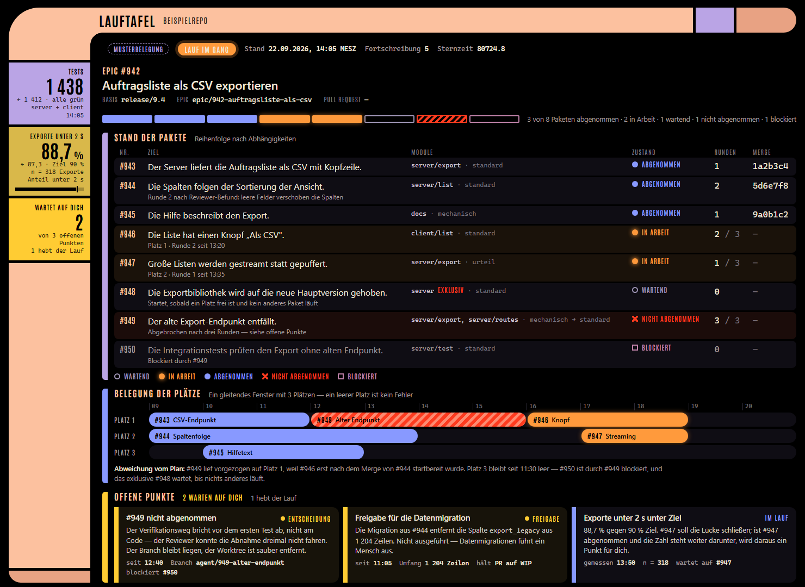

# agent-skills

Die versionierte Quelle unserer Claude-Code-Skills: Agenten setzen damit freigegebene Epics aus
Gitea um, von der Freigabe bis zum Pull Request. Einrichten: [`INSTALL.md`](INSTALL.md).
Begriffe: [`CONTEXT.md`](CONTEXT.md).

## Der Ablauf


Die orangen Halte sind die Stellen, an denen du entscheidest. Dazwischen läuft alles ohne
Rückfrage; den Stand zeigen Gitea und KIBO.

## Die Skills

| Skill | Wofür |
|---|---|
| `epic` | Ein Epic (Kind-Tickets oder Spec) auf einem Epic-Branch umsetzen, endet mit offenem PR |
| `epic-nacharbeit` | Die offenen Punkte eines abgeschlossenen Laufs in Fragerunden klären und erledigen |
| `epic-aufraeumen` | Nach dem Merge Worktrees und Branches abräumen, nur was nachweislich gemergt ist |
| `epic-flotte` | Optional: mehrere Epics gleichzeitig, geführt von einem Admiral |
| `epic-lagebesprechung` | Optional: im laufenden Chat alles abholen, was bei dir liegt |
| `mail-antwort` | Eine Anwender-Mail recherchieren, bei Bedarf umsetzen, Antwort entwerfen |

Alle Epic-Skills lesen im Zielprojekt die Adapterdatei `.claude/epic.md`
([Vertrag](epic/references/adapter.md)) und fragen mit Antwortmöglichkeiten und Empfehlung. Bis
Oktober 2026 hießen sie `prd…`; alte Adapter werden weiter gelesen.

## `/epic` — ein Lauf


Opus macht nicht alles: Die Paketklasse wählt Modell und Denkstufe, Opus hoch gibt es nur nach
einer Eskalation. Am Ende stehen je Ticket Fundstellen, Verifikation und offene Punkte in Gitea.

Den Stand zeigt die **Lauftafel** im Browser — hier mit den Musterdaten der Vorlage:



## `/epic-flotte` — mehrere Epics gleichzeitig


- Läufe sind Subagenten; ihre Fragen beantwortet der Admiral, soweit sein Entscheidungsrecht
  reicht, jede Entscheidung mit Herkunft in Gitea. Was bis zum Merge umkehrbar ist, entscheidet er
  **vorläufig** — du bestätigst oder kippst, bis dahin trägt der PR `WIP:`.
- Eine **Verbrauchsbremse** liest 5-Stunden- und Wochenlimit: bei Gelb nichts Neues, bei Rot Pause
  bis zum Reset. Den Stand schreibt der Admiral ins Issue `Flottenlogbuch`, das KIBO anzeigt.

Die **Flottentafel** zeigt dir im Browser, wo jeder Lauf steht und was bei dir liegt — hier mit
den Musterdaten der Vorlage:


## `/epic-lagebesprechung` — wenn du Zeit hast


Ein Einschub, kein eigener Lauf: Aufgerufen im Chat des Admirals oder Orchestrators, ändert sie
deren Ablauf nicht.

## `mail-antwort` — Anwender-Mail beantworten


## Plugin `agentenflotte`


Ein Mod, der die Sitzung zur Schiffsbrücke macht: Subagenten sind Schiffe, Warpfaktor ist die
Denkstufe, Alarmstufen zeigen, was auf dich wartet (Gelb Freigabe, Rot Fehler, Blau Kontext knapp).
Dazu Statuszeile, `/logbuch`, `/taktik` (Radar der Flotte) und ein optionaler Bordcomputer.
`/flotte` schaltet den Mod, `/flotte status` zeigt die Teile. Übernommen aus
[interias/agentenflotte](https://github.com/interias/agentenflotte).

## Aufbau

```
epic/ epic-nacharbeit/ epic-aufraeumen/   die Epic-Skills (epic/references: Adapter, Forge, Tafeln)
epic-flotte/ epic-lagebesprechung/        optional: Flotte und Lagebesprechung
mail-antwort/                             Skill mit Python-Skripten
agents/                                   Agent-Typen der Modellstaffel
agentenflotte/  .claude-plugin/           Plugin und Marketplace breuckmann-agent-skills
mattpocock-skills/                        Einrichtung der vorgelagerten Skills für Gitea
assets/                                   Bilder dieses README, je mit HTML-Quelle
install.ps1  INSTALL.md
```

Änderungen nur über Branch und Pull Request, nie direkt in `~/.claude/skills`.
