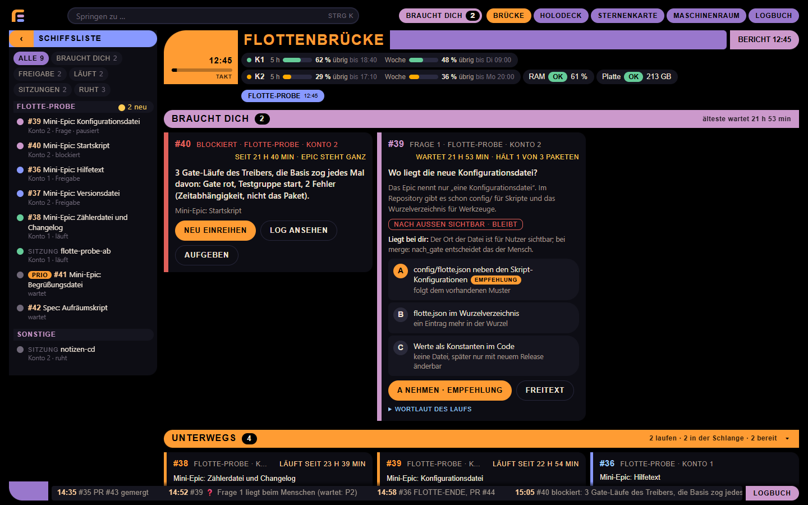

<h1> agent-skills</h1>

Claude-Code-Skills, mit denen Agenten freigegebene Epics aus der Forge (Gitea oder GitHub)
umsetzen: vom Issue bis zum Pull Request, in parallelen Paketen, jedes geprüft. Ein Programm, der
Flotten-Treiber, führt mehrere solcher Läufe gleichzeitig auf einem oder mehreren Claude-Konten;
die Flottenbrücke zeigt, was dich braucht, und nimmt deine Antworten an. Gemergt wird nur so, wie
der Adapter des Projekts es erlaubt.

## Das Bild

<picture>
  <source media="(max-width: 600px)" srcset="assets/readme/ablauf-schmal.png">
  
</picture>

Ob der Treiber oder du im Chat einen Lauf startet, ändert nichts daran, wer mergt. **Welchen Weg
wann:** Der Treiber ist der Regelweg, auch für ein einzelnes Epic; er verteilt Läufe auf Konten,
bremst bei vollem Speicher oder Limit, legt dir nur die Fragen vor, die bei dir liegen, und fährt
`/epic-nacharbeit` von selbst. Einen Lauf im Chat startest du, wenn du ein Epic begleiten willst,
etwa das Vorab-Tor selbst beantworten; dann gehört `/epic-nacharbeit` vor den Merge, solange der PR
offen ist.

Ein **Lauf** (`/epic`) liest das Epic, schneidet es in Pakete, fragt einmal am Vorab-Tor und setzt
dann bis zu drei Pakete gleichzeitig um, jedes in eigenem Worktree mit Implementer, Reviewer und
Nachprüfung. Er endet mit einem offenen Pull Request. Den Stand zeigt im Einzellauf die
**Lauftafel** im Browser; unter dem Treiber gibt es keine, dort zeigt ihn die Brücke. Was ein Lauf
fragt, geht so weiter:

<picture>
  <source media="(max-width: 600px)" srcset="assets/readme/rueckfrage-schmal.png">
  
</picture>

## Die Brücke

Fünf Bereiche, oben als Pillen, auf dem Handy unten in Daumenreichweite; der Zähler „Braucht dich“
steht auf jeder Seite, die Schiffsliste links zeigt alle Läufe und Sitzungen.

- **Brücke:** was du tun musst, in drei Ebenen: **Braucht dich** (Fragen und blockierte Epics, mit
  „Neu einreihen“ und „Aufgeben“), **Unterwegs** (Läufe mit Lebenszeichen und Merge-Schlange),
  **Erledigt heute**. Die **Detailansicht** eines Epics zeigt je Paket Phase, Runde und Stufe und
  darunter die **Entscheidungen bis zum Merge**: deine und die des Admirals, jede bis zum Merge
  zurücknehmbar.
- **Holodeck:** die Prototypen der Projekte zum Ansehen, als Schreibtisch oder Telefon.
- **Sternenkarte:** Projekte mit ihrem Backlog und der Reihenfolge der Epics.
- **Maschinenraum:** Tanks je Konto, RAM und Platte je Rechner, Bremsstufe und ihr Grund.
- **Logbuch:** Ereignisse, Entscheidungen des Admirals und deine Handlungen.

<picture>
  <source media="(max-width: 600px)" srcset="flottenbruecke/doku/v3-bruecke-390.png">
  
</picture>

Bilder aller Bereiche und der Detailansicht, je 1440 und 390 px breit: [`flottenbruecke/doku/`](flottenbruecke/doku/);
alles Weitere im [README der Brücke](flottenbruecke/README.md).

## Schnellstart

1. **Installieren** (Windows, PowerShell), Einzelheiten in [`INSTALL.md`](INSTALL.md):

   ```powershell
   powershell -File install.ps1 -DryRun
   powershell -File install.ps1
   ```

2. **Adapter anlegen:** `.claude/epic.md` im Zielprojekt. Die Skripte lesen nur das Frontmatter;
   alle Schlüssel und Standards stehen in [`epic/references/adapter.md`](epic/references/adapter.md).
   Fehlt der Adapter, leitet der erste Lauf ab, was geht, fragt den Rest am Vorab-Tor und bietet an,
   die Datei abzulegen.

   ```yaml
   ---
   forge: github
   push_remote: origin
   main_branch: main
   ready_label: ready-for-agent
   epic_label: epic
   test_commands:
     unit: npm test
   lint_commands:
     web: npm run lint
   isolation: none-needed
   merge: mensch
   ---
   ```

   Erst `isolation: none-needed` (mit Begründung in der Prosa darunter) oder `test_isolation_env`
   lässt drei Pakete gleichzeitig laufen. Mit `merge: nach_gate` mergt der Treiber nach grünem
   Gate; dafür braucht er `gate_command`.

   Labels im Repository: `ready-for-agent` (Freigabe), `epic` und für den Flotten-Treiber
   `prio/hoch` (Vorrang in der nächsten Belegung, Name über `prio_label` änderbar).

3. **Erster Lauf:** ein Epic mit `ready-for-agent` freigeben, in Claude Code im Projekt
   `/epic #<nr>` aufrufen, am Vorab-Tor antworten, am Ende den Pull Request prüfen und mergen.
   Danach `/epic-nacharbeit` und nach dem Merge `/epic-aufraeumen`.
4. **Flotte fahren:** aus einem Terminal im Projektordner, nicht aus einer Sitzung (Bun nötig):

   ```powershell
   bun "$HOME\.claude\skills\flotte\src\cli.ts" fahren --konten 1,2 --bruecke http://127.0.0.1:4747
   ```

   Ohne `--epics` nimmt der Treiber alle freigegebenen Epics. Das zweite Konto richtet
   [`arbeitspferd/einrichten.ps1`](arbeitspferd/README.md) ein, die Brücke startet mit
   `docker compose up -d` in [`flottenbruecke/`](flottenbruecke/README.md). Alle Schalter:
   [`flotte/SKILL.md`](flotte/SKILL.md).

## Die Teile

| Teil | Was es tut | Doku |
|---|---|---|
| `epic` | Ein Epic auf einem Epic-Branch umsetzen, endet mit offenem PR | [für Menschen](epic/README.md), [Skill](epic/SKILL.md), [Skripte](epic/scripts/README.md) |
| `epic-nacharbeit` | Offene Punkte eines Laufs in Fragerunden klären und erledigen | [für Menschen](epic-nacharbeit/README.md), [Skill](epic-nacharbeit/SKILL.md) |
| `epic-aufraeumen` | Nach dem Merge Worktrees und Branches abräumen, nur nachweislich Gemergtes | [für Menschen](epic-aufraeumen/README.md), [Skill](epic-aufraeumen/SKILL.md) |
| `flotte` | Treiber: mehrere Läufe als `claude -p` auf mehreren Konten, Bremsen, Merge-Schlange, Logbuch | [für Menschen](flotte/README.md), [Skill](flotte/SKILL.md), [Umschalten](flotte/references/umschalten.md) |
| `flottenbruecke/` | Dauerdienst im LAN: fünf Bereiche über alle Einsätze, Antworten per PIN; steuert sonst nichts | [README](flottenbruecke/README.md), [Schnittstelle](flottenbruecke/SCHNITTSTELLE.md) |
| `epic-flotte` | Dasselbe wie `flotte`, aber als Admiral-Chat | [für Menschen](epic-flotte/README.md), [Skill](epic-flotte/SKILL.md) |
| `epic-lagebesprechung` | Im laufenden Chat abholen, was bei dir liegt | [für Menschen](epic-lagebesprechung/README.md) |
| `bereitschaftsraum` | Gespräch in Fragerunden, aus dem eine Mission, ein Missionsziel oder nichts entsteht; angelegt wird über `flotte auftrag` | [Skill](bereitschaftsraum/SKILL.md) |
| `codebase-design` | Wortschatz für tiefe Module: Schnittstelle, Naht, Tiefe, Löschprobe | [Skill](codebase-design/SKILL.md) |
| `research` | Eine Frage aus Primärquellen beantworten, als Markdown-Datei mit Fundstellen festhalten | [Skill](research/SKILL.md) |
| `prototype` | Wegwerf-Prototyp für eine Entwurfsfrage; HTML-Prototypen liegen im `prototype_dir` (Holodeck) | [Skill](prototype/SKILL.md) |
| `tdd` | Test zuerst, je Abnahmepunkt eine Runde; Tests am Rand des Bausteins | [Skill](tdd/SKILL.md) |
| `diagnosing-bugs` | Fehler erst mit einer Probe eingrenzen, dann vermuten, messen, beheben | [Skill](diagnosing-bugs/SKILL.md) |
| `code-inspektion` | Änderung seit einem festen Punkt prüfen: Spec und Standards getrennt, Befunde als Muss, Sollte, Kann | [Skill](code-inspektion/SKILL.md) |
| `arbeitspferd/` mit `leitstand` | Weitere Konten einrichten; aus der Hauptsitzung Aufträge an Konto 2 geben, überwachen, PRs nach `merge` mergen | [README](arbeitspferd/README.md), [Leitstand für Menschen](arbeitspferd/leitstand/README.md), [Skill](arbeitspferd/leitstand/SKILL.md) |
| `agents/` | Agent-Typen der Modellstaffel (Kundschafter, Implementer, Reviewer, Lauf) | [Staffel](epic/README.md#modelle-und-denkstufen) |
| `mail-antwort` | Anwender-Mail recherchieren, bei Bedarf umsetzen, Antwort entwerfen | [für Menschen](mail-antwort/README.md) |
| `persona-review` | Bedienung mit Persona-Agenten über Runden messen | [für Menschen](persona-review/README.md) |
| `mattpocock-skills/` | Einrichtung der vorgelagerten Skills (`grill-with-docs`, `to-spec`, `to-tickets` …) für Gitea | [README](mattpocock-skills/README.md) |
| `assets/` | Bilder der Doku, je mit Quelle und Anleitung zum Neurendern | — |

## Begriffe

Kurz; die verbindliche Fachsprache steht in [`CONTEXT.md`](CONTEXT.md).

- **Epic:** das Zielissue eines Laufs, mit **Kindern** (Tickets) oder als **Spec** mit sieben
  festen Abschnitten, die der Lauf selbst in Pakete schneidet.
- **Paket** und **Paketklasse:** ein Stück Arbeit mit eigenem Branch und Worktree; die Klasse
  (*mechanisch*, *Standard*, *Urteil*) wählt Modell und Denkstufe. **Eskalation** wiederholt eine
  Runde eine Klasse höher.
- **Orchestrator:** die Sitzung, die `/epic` fährt; schneidet, prüft nach, mergt Pakete in den
  Epic-Branch. **Kundschafter** lesen nur.
- **Vorab-Tor:** die eine Fragerunde zu Beginn eines Laufs.
- **Admiral:** das Sprachmodell, das Fragen der Läufe im Rahmen seines Entscheidungsrechts
  beantwortet, als Chat (`/epic-flotte`) oder je Frageblock unter dem **Treiber** (`flotte`).
- **Adapter:** `.claude/epic.md` des Projekts; darf die Regeln der Skills verschärfen, nie lockern.
- **Gate-Block:** die Ausgabe des Projekt-Gates in der PR-Beschreibung, mit Basis- und Head-SHA.
  **Gate-Nachweis:** der Treiber prüft im Log des Laufs, dass dieser Block aus einem echten
  Gate-Aufruf stammt.
- **Konto:** ein Claude-Konfigordner (`~/.claude`, `~/.claude-arbeitspferd`, …); ein Epic bleibt
  bei seinem Konto.

## Grenzen

- **Kein Lauf mergt**, auch `gh pr merge` ist gesperrt. Wer mergt, sagt allein der Adapterschlüssel
  `merge`: Standard `mensch`; bei `nach_gate` genau ein Akteur (Treiber oder `merge.ps1` des
  Leitstands), nur mit gültigem Gate-Block auf aktueller Basis und Head, grünen Checks und immer
  mit Merge-Commit. Der Admiral mergt nie.
- **Kein Push auf Hauptzweig oder Basis**, nur auf das Remote des Adapters; das Hauptverzeichnis
  wird nie auf einen anderen Branch umgeschaltet. `guard.ps1` sperrt das als Hook.
- **Keine Datenmigration, keine gelöschten oder übersprungenen Tests**, nichts über die
  Abnahmeliste hinaus.
- **Was sich nach dem Merge nicht widerrufen lässt, liegt bei dir:** Produktivdaten, Zugriffe,
  Freigaben aus `gate_approvals`, gelockerte Regeln, gelöschte Remote-Branches.
- **Bremsen:** Ab der RAM-Schwelle startet kein neues Paket; der Treiber hält bei gelbem Limit
  Neues und bei rotem auch Fortsetzungen an.
- **Aufräumen löscht nur**, was nachweislich im Basiszweig liegt, nie mit `-D` oder `--force`.
- **Die Brücke steuert nichts:** kein Starten, Stoppen oder Mergen; nur im LAN, Antworten nur mit
  PIN.
- **Nichts nur im Chat:** Jede Entscheidung und jeder Abschluss steht als Kommentar in der Forge.

## Ändern

Änderungen nur über Branch und Pull Request, nie direkt in `~/.claude/skills`. Wirksam werden sie
nach `install.ps1` in einer neuen Sitzung.

Die Leiter „kleinste vollständige Änderung" der Implementer und die Befundform der Reviewer
stammen aus [Ponytail](https://github.com/DietrichGebert/ponytail) von Dietrich Gebert (MIT), die
vorgelagerten Skills aus dem Plugin `mattpocock-skills`. Das Plugin `agentenflotte` wird unter
[interias/agentenflotte](https://github.com/interias/agentenflotte) gepflegt.
