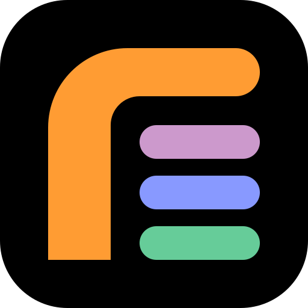

<h1> agent-skills</h1>

Claude-Code-Skills, mit denen Agenten freigegebene Missionen aus der Forge (Gitea oder GitHub)
umsetzen: vom Issue bis zum Pull Request, in parallelen Paketen, jedes geprüft. Ein Programm, der
Flotten-Treiber, führt mehrere solcher Läufe gleichzeitig auf einem oder mehreren Claude-Konten;
die Flottenbrücke zeigt, was dich braucht, und nimmt deine Antworten an. Angedockt wird nur so, wie
der Adapter des Projekts es erlaubt.

**Worum es geht:** mehr Durchsatz bei gleicher Qualität und weniger Rauschen für den Menschen. Läufe
arbeiten selbstständig bis zum Pull Request; der Admiral entscheidet alles, was nicht bei dir liegt, und
du siehst nur, was dich wirklich braucht. Tests werden gezielt geschnitten statt wiederholt, Modelle nach
Schwierigkeit gewählt, und jede Regel steht so, dass ein Mensch sie lesen und ein Test sie halten kann.

## Wie eine Mission läuft

Vom freigegebenen Issue über parallele Pakete bis zum Andocken; wer startet und wer andockt, sind zwei getrennte Fragen.

<picture>
  <source media="(max-width: 600px)" srcset="assets/readme/ablauf-schmal.png">
  
</picture>

Mehr, auch die Implementierungsschleife und der Zuschnitt der Tests: [`docs/ablauf.md`](docs/ablauf.md).

## Wenn ein Lauf fragt

Fragen gehen erst an den Admiral; nur was bei dir liegt, kommt auf die Brücke.

<picture>
  <source media="(max-width: 600px)" srcset="assets/readme/rueckfrage-schmal.png">
  
</picture>

Mehr: [`docs/ablauf.md`](docs/ablauf.md#wenn-ein-lauf-fragt).

## Die Brücke

Ein Dienst im LAN, der zeigt, was dich braucht, und deine Antworten annimmt.

<picture>
  <source media="(max-width: 600px)" srcset="flottenbruecke/doku/v3-bruecke-390.png">
  
</picture>

Alle Bereiche und Bilder: [README der Brücke](flottenbruecke/README.md).

## Wer entscheidet

Sechs Prüffragen trennen, was der Admiral entscheidet und was bei dir liegt; dieselben Fragen entscheiden, ob aus einem Punkt ein Ticket wird.

<picture>
  <source media="(max-width: 600px)" srcset="assets/readme/befugnisse-schmal.png">
  
</picture>

Tabellen, Wortlaut, die Grenze „nur Software“ (Inhaltsziele bekommen `ready-for-human`) und wo die KI jede Regel prüft: [`docs/befugnisse.md`](docs/befugnisse.md).

## Die Teile

| Teil | Was es tut | Doku |
|---|---|---|
| `mission` | Eine Mission auf einem Missions-Branch umsetzen, endet mit offenem PR | [für Menschen](mission/README.md), [Skill](mission/SKILL.md), [Skripte](mission/scripts/README.md) |
| `mission-nacharbeit` | Offene Punkte eines Laufs in Fragerunden klären und erledigen | [für Menschen](mission-nacharbeit/README.md), [Skill](mission-nacharbeit/SKILL.md) |
| `mission-aufraeumen` | Nach dem Andocken Worktrees und Branches abräumen, nur nachweislich Angedocktes | [für Menschen](mission-aufraeumen/README.md), [Skill](mission-aufraeumen/SKILL.md) |
| `flotte` | Treiber: mehrere Läufe als `claude -p` auf mehreren Konten, Bremsen, Andock-Schlange, Logbuch | [für Menschen](flotte/README.md), [Skill](flotte/SKILL.md) |
| `flottenbruecke/` | Dauerdienst im LAN: fünf Bereiche über alle Einsätze, Antworten per PIN; steuert sonst nichts | [README](flottenbruecke/README.md), [Schnittstelle](flottenbruecke/SCHNITTSTELLE.md) |
| `bereitschaftsraum` | Gespräch in Fragerunden, aus dem eine Mission, ein Missionsziel oder nichts entsteht; angelegt wird über `flotte auftrag` | [Skill](bereitschaftsraum/SKILL.md) |
| `codebase-design` | Wortschatz für tiefe Module: Schnittstelle, Naht, Tiefe, Löschprobe | [Skill](codebase-design/SKILL.md) |
| `research` | Eine Frage aus Primärquellen beantworten, als Markdown-Datei mit Fundstellen festhalten | [Skill](research/SKILL.md) |
| `prototype` | Wegwerf-Prototyp für eine Entwurfsfrage; HTML-Prototypen liegen im `prototype_dir` (Holodeck) | [Skill](prototype/SKILL.md) |
| `tdd` | Test zuerst, je Abnahmepunkt eine Runde; Tests am Rand des Bausteins | [Skill](tdd/SKILL.md) |
| `diagnosing-bugs` | Fehler erst mit einer Probe eingrenzen, dann vermuten, messen, beheben | [Skill](diagnosing-bugs/SKILL.md) |
| `code-inspektion` | Änderung seit einem festen Punkt prüfen: Spec und Standards getrennt, Befunde als Muss, Sollte, Kann | [Skill](code-inspektion/SKILL.md) |
| `arbeitspferd/` | Weitere Konten einrichten | [README](arbeitspferd/README.md) |
| `agents/` | Agent-Typen der Modellstaffel (Kundschafter, Ingenieur, Erster Offizier) | [Staffel](mission/README.md#modelle-und-denkstufen) |
| `mail-antwort` | Anwender-Mail recherchieren, bei Bedarf umsetzen, Antwort entwerfen | [für Menschen](mail-antwort/README.md) |
| `persona-review` | Bedienung mit Persona-Agenten über Runden messen | [für Menschen](persona-review/README.md) |
| `assets/` | Bilder der Doku, je mit Quelle und Anleitung zum Neurendern | — |

## Loslegen

Installieren nach [`INSTALL.md`](INSTALL.md); Adapter, erster Lauf und Flotte in
[`docs/ablauf.md`](docs/ablauf.md#loslegen).

## Begriffe und Quellen

Die Fachsprache steht in [`CONTEXT.md`](CONTEXT.md), Entscheidungen in [`docs/adr/`](docs/adr/), Wissen
für Agenten in [`AGENTS.md`](AGENTS.md). Die Leiter „kleinste vollständige Änderung" des Ingenieurs und
die Befundform des Ersten Offiziers stammen aus [Ponytail](https://github.com/DietrichGebert/ponytail)
von Dietrich Gebert (MIT); alle Quellen in [`QUELLEN.md`](QUELLEN.md). Das Plugin `agentenflotte` wird
unter [interias/agentenflotte](https://github.com/interias/agentenflotte) gepflegt.
