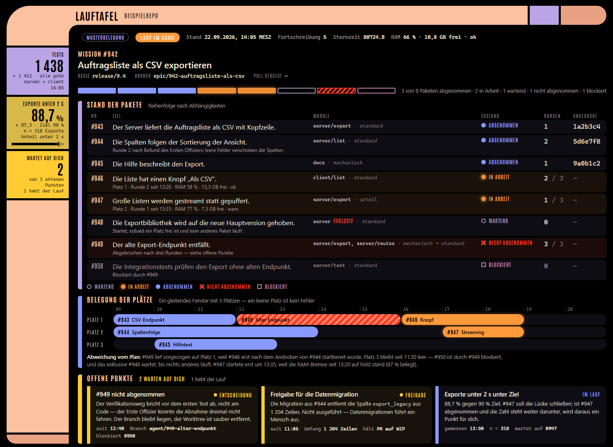

# `/epic` für Menschen

Was du als Nutzer über einen Lauf wissen musst: wie er arbeitet, welche Regeln greifen, wo du
entscheidest. Die Anweisungen an den Agenten stehen in [`SKILL.md`](SKILL.md), der Vertrag des
Projektadapters in [`references/adapter.md`](references/adapter.md), die Skripte in
[`scripts/README.md`](scripts/README.md).

## Der Ablauf

Die orangen Halte sind die Stellen, an denen du entscheidest. Dazwischen läuft alles ohne
Rückfrage; den Stand zeigt die Forge.

1. **Plan klären und Epic schneiden** im Gespräch des
   Bereitschaftsraums ([Skill](../bereitschaftsraum/SKILL.md)).
2. **Freigeben:** Label `ready-for-agent` an der Spec oder an den Kind-Tickets.
3. **`/epic #<nr>` starten** und am Vorab-Tor einmal alle Fragen beantworten.
4. **Pull Request prüfen und mergen.** Das tut kein Lauf. Ob ein Mensch mergt oder nach grünem
   Gate genau ein Akteur außerhalb des Laufs, sagt der Adapterschlüssel `merge` (Standard: der Mensch).
5. **`/epic-nacharbeit`** für die offenen Punkte, nach dem Merge **`/epic-aufraeumen`**.

Ein Kind-Ticket braucht eine Abnahmeliste und einen Verifikationsweg, sonst überspringt der Lauf
es mit Kommentar. Eine Spec hat sieben feste Abschnitte; ihre User Stories sind die Abnahmeliste.

## Ein Lauf

Deine Sitzung ist der **Orchestrator**: Er schneidet, prüft nach und mergt in den Epic-Branch, die
Pakete setzen Subagenten um.

1. **Rüsten:** Reste toter Sitzungen abräumen, Epic-Worktree anlegen, den Ausgangsstand von Tests
   und Lint messen und, wenn Graphify installiert ist, den **Code-Graphen** bauen.
2. **Lesen und schneiden:** das Issue ganz lesen, Pakete bilden, jedem eine **Paketklasse** geben
   (mechanisch, Standard, Urteil), Abhängigkeiten und Kollisionen als Graph.
3. **Vorab-Tor:** alles Fragwürdige in einer Runde, mit Antwortmöglichkeiten und Empfehlung.
4. **Je Paket**, bis zu `window` gleichzeitig: eigener Branch und Worktree → Implementer →
   Reviewer → der Orchestrator fährt die Verifikation selbst → Commit → Sofortmerge in den
   Epic-Branch. Ein frei werdender Platz wird sofort neu belegt.
5. **Abschluss:** Gesamtlauf aller Tests, Abnahmestufe, Push, Pull Request, Abschlusskommentar.

Der **Code-Graph** ist eine Landkarte des Codes: wer ein Symbol oder eine Datei aufruft, importiert
oder davon abhängt, mit Datei und Zeile. [Graphify](https://github.com/Graphify-Labs/graphify)
liest ihn lokal aus dem Quelltext, ohne Modell; er liegt im Git-Verzeichnis (`.git/epic-graph/`),
nicht im Arbeitsbaum, und wird nach jedem Sofortmerge erneuert. Orchestrator, Implementer und
Reviewer fragen ihn, statt den Baum zu durchsuchen. Er ist optional und ersetzt keine Prüfung:
Aufrufer in Tests können fehlen, deshalb endet die Suche nach betroffenen Stellen weiter mit
einem gezielten `grep`.

Den Stand zeigt die **Lauftafel** im Browser, hier mit den Musterdaten der Vorlage. Unter dem
Flotten-Treiber gibt es keine; dort zeigt die [Flottenbrücke](../flottenbruecke/README.md) den Stand.

**Womit du rechnen kannst** (7 Läufe, 61 Pakete, 26.10.–11.11.2026): Ein Implementer braucht im
Median 12 Minuten (Urteil 22, Standard 7, mechanisch 1), ein Reviewer 5. Worktree anlegen und
abräumen dauern Sekunden. Die Wanduhr zeigt je Paket deutlich mehr als die Arbeitszeit der
Agenten; der Rest ist Stillstand: Warten auf eine Antwort, auf ein Limit, über Nacht.

## Die Regeln, die greifen

**Was ein Lauf nie tut**

- Er mergt und pusht nie in den Hauptzweig oder die Basis; er endet mit einem offenen Pull
  Request, auch `gh pr merge` ist gesperrt. Gepusht wird nur auf das Remote aus dem Adapter. Das
  Hauptverzeichnis wird nie auf einen anderen Branch umgeschaltet. Diese drei sperrt ein Hook
  (`guard.ps1`).
- Er führt keine Datenmigration aus, löscht oder überspringt keine Tests und baut nichts über die
  Abnahmeliste hinaus. Reviewer legen keine Issues an.

**Wann er fragt**

- Einmal, am Vorab-Tor. Danach hält er nicht mehr an: Was schiefgeht, lässt ein Paket zurück
  (Branch bleibt, Ticket bekommt `status/haengt`), seine Nachfolger werden blockiert, alle anderen
  laufen weiter.
- Die Ausnahme ist die **RAM-Bremse**: Ab 85 % belegtem Speicher startet kein neues Paket, bis
  wieder Platz ist oder du freigibst. Ein voller Stack läuft im Projekt immer nur einmal.

**Wie ein Paket geprüft wird**

- **Implementer** bauen die kleinste vollständige Änderung: erst vorhandenen Code, dann
  Standardbibliothek und installierte Abhängigkeiten, sonst das Minimum. Sie testen gezielt und
  fahren am Ende einen Volllauf. Ihr Bericht endet mit dem, was sie ausgelassen oder nicht geprüft
  haben.
- **Reviewer** prüfen Spec und Standards getrennt und melden Befunde als Muss, Sollte, Kann, jeden
  mit Fundstelle und konkretem Fall. Nur ein Muss-Befund löst eine neue Runde aus; eine
  strukturelle Abweichung wiederholt die Runde eine Paketklasse höher (Eskalation). Nach drei
  Runden bleibt das Paket zurück.
- **Der Orchestrator** glaubt keinem Bericht: Er fährt den Verifikationsweg selbst und vergleicht
  Test- und Lint-Zahlen mit dem Ausgangsstand. Eine gesunkene Testzahl ist ein Befund, auch wenn
  alles grün ist.
- **Kein Zug endet wartend.** Ein Subagent, der ohne Bericht zurückkommt, wird einmal fortgesetzt
  und dann ersetzt.

**Was in der Forge steht**

- Jedes berührte Issue bekommt einen Kommentar: je Abnahmepunkt die Fundstelle, die gefahrene
  Verifikation, die offenen Punkte. Nichts existiert nur im Chat.
- Drei Statuslabels zeigen den Zustand (`status/in-arbeit`, `status/blockiert`, `status/haengt`);
  sie steuern nichts.
- Der Pull Request trägt `WIP:`, solange etwas bei dir liegt, und schließt abgenommene Kinder über
  `Closes`.

## Modelle und Denkstufen

Die Paketklasse wählt Modell und Denkstufe; das teuerste Modell sitzt nur dort, wo entschieden
wird. Die Agent-Typen liegen unter [`agents/`](../agents/).

| Rolle | Agent-Typ | Modell, Denkstufe |
|---|---|---|
| Orchestrator eines Laufs | — | das Modell deiner Sitzung; unter der Flotte Opus, mittel |
| Admiral der Flotte | — | Fable 5.2, hoch |
| Kundschafter (liest nur) | `epic-kundschafter` | Haiku, niedrig |
| Implementer *mechanisch* | `epic-implementer-mechanisch` | Sonnet, niedrig |
| Implementer *Standard* | `epic-implementer-standard` | Sonnet, mittel |
| Implementer *Urteil*, erste Eskalation von Standard | `epic-implementer-urteil` | Opus, mittel |
| Implementer nach einer Eskalation aus Urteil | `epic-implementer-urteil-hoch` | Opus, hoch |
| Reviewer *mechanisch* und *Standard* | `epic-reviewer-standard` | Sonnet, hoch |
| Reviewer *Urteil* | `epic-reviewer-urteil` | Opus, mittel |
| Lauf als Subagent unter `/epic-flotte` (Rückfall) | `epic-lauf` | Opus, mittel; Cache eine Stunde |

Der Reviewer ist nie schwächer als der Implementer. Der Admiral hat wenige, folgenreiche Züge; die
Masse der Arbeit machen die Orchestratoren der Läufe und die Implementer. Deshalb läuft nur er auf
Fable.

Ein Subagent hält seinen Cache sonst fünf Minuten. Der Lauf-Agent wartet auf jede Welle länger und
schrieb danach seinen ganzen Kontext neu; mit dem Stunden-Cache (`experimental.cacheTtl: 1h`, ab
Claude Code 2.1.248) entfällt das.

## Nach dem Lauf

- **[`/epic-nacharbeit`](../epic-nacharbeit/SKILL.md)** arbeitet ab, was der Lauf offen gelassen
  hat. Jeder Punkt wird einzeln in einer Fragerunde entschieden, bevor er angefasst wird: passt er
  in die Sitzung oder braucht er ein Ticket. Issues legt der Skill nur nach deiner ausdrücklichen
  Entscheidung an. Sind alle Kinder zu, schließt er das Epic.
- **[`/epic-aufraeumen`](../epic-aufraeumen/SKILL.md)** läuft nach dem Merge. Es löscht nur, was
  nachweislich im Basiszweig liegt, nie mit `-D` oder `--force`, und einen Remote-Branch nur nach
  deiner Zustimmung. Was wann aufgeräumt wird: [`scripts/README.md`](scripts/README.md).
